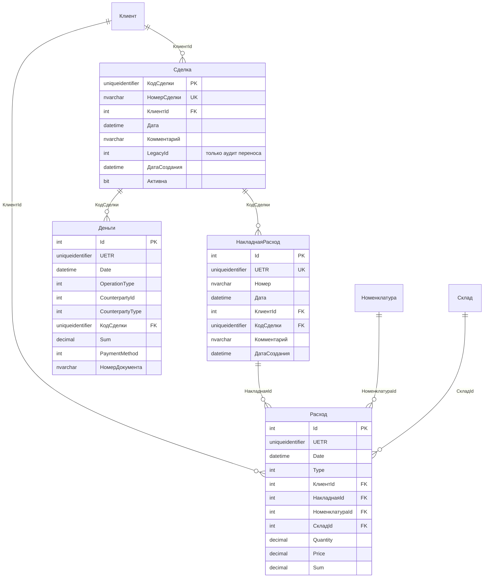

# Схема БД `Sklad-v4.1` — версия 4.1

Версия 4 (`Sklad-v4`) плюс слой взаиморасчётов с клиентом. Ядро
(**Приход / Расход / Деньги** на общем `UETR`), справочники, ревизии и
система характеристик перенесены из v4 без изменений.

Добавлены:

- **`Сделка`** — договорённость с клиентом и её сквозной ключ `КодСделки`;
- **`НакладнаяРасход`** — шапка отгрузки (номер, дата, клиент, сделка);
- **`Расход.НакладнаяId`** — строка накладной ссылается на шапку;
- **`Деньги.КодСделки`** — платёж клиента привязан к сделке;
- представления **`vw_БалансСделки`**, **`vw_БалансКлиента`**,
  **`vw_ДвиженияПоСделке`**;
- триггеры согласованности клиента между сделкой, накладной, строкой и
  платежом.

Долг по сделке **не хранится** — он вычисляется. Это главное отличие от
эталона и от буквального текста задачи 04.

## Что изменилось относительно `Sklad-v4`

| Объект | Изменение |
|--------|-----------|
| `Сделка` | **новая** — `КодСделки`, `НомерСделки`, клиент, дата, комментарий, `LegacyId` |
| `НакладнаяРасход` | **новая** — шапка: `UETR` (уникальный), номер, дата, клиент, `КодСделки` |
| `Расход` | + `НакладнаяId` (FK, `ON DELETE CASCADE`); `СкладРасход` из задачи — это и есть `Расход` |
| `Деньги` | + `КодСделки` (FK), + `НомерДокумента` |
| `Клиент` | + `ДатаСоздания`, + `Активен` |
| `vw_БалансСделки` | **новое** — отгружено / оплачено / долг / переплата |
| `vw_БалансКлиента` | **новое** — свод по клиенту и предел кредита |
| `vw_ДвиженияПоСделке` | **новое** — документы сделки с нарастающим итогом |
| `TR_НакладнаяРасход_Проверка` | **новый** — клиент накладной = клиент сделки |
| `TR_Расход_Проверка` | **новый** — строка совпадает с шапкой по клиенту и `UETR` |
| `TR_Деньги_Проверка` | **новый** — платёж по сделке клиентский и принадлежит клиенту сделки |

## Зачем нужен `КодСделки`

Один клиент заводит несколько сделок. Внутри сделки товар отгружается
частями и оплачивается частями. Без общего ключа бухгалтер не может
ответить, за какую именно отгрузку пришли деньги.

```
Клиент ──1:N── Сделка ──1:N── НакладнаяРасход ──1:N── Расход
                  └────1:N── Деньги
```

- у клиента много сделок;
- у сделки много накладных и много платежей;
- каждая накладная и каждый платёж ссылаются на **один** `КодСделки`;
- долг считается по одной сделке, а не по всей истории клиента.

`КодСделки` — `uniqueidentifier`. `НомерСделки` (`R-000001`) — то, что
видит пользователь; он уникален и неизменяем.

## Нумерация сделок

Номер выдаёт последовательность `seq_НомерСделки` через `DEFAULT`:

```sql
НомерСделки nvarchar(20) NOT NULL
    CONSTRAINT DF_Сделка_НомерСделки
    DEFAULT ('R-' + RIGHT('000000'
             + CAST(NEXT VALUE FOR dbo.seq_НомерСделки AS varchar(10)), 6))
```

Свойства:

- **ровный ряд** — после переноса `R-000001 … R-000150`, следующая сделка
  получает `R-000151`;
- **уникальность** — `UNIQUE (НомерСделки)`, плюс сама последовательность
  не выдаёт одно число дважды;
- **concurrency-safe** — два одновременных `INSERT` не получат один номер;
- **неизменяемость** — отменённая сделка получает `Активна = 0`, номер не
  переиспользуется;
- **латиница** — `R`, а не кириллическая `Р`: номер попадает в URL, JSON и
  Excel, а `Р`/`P` визуально неразличимы;
- **предел 999999** — формат шестизначный. При достижении предела
  `UNIQUE` не даст создать дубль, но лучше расширить формат заранее.

`НомерСделки` не является первичным ключом: PK — `КодСделки`, потому что он
не зависит от формата и не меняется при возможной перенумерации.

## Почему долг не хранится

В эталоне `КлиентМеткаРасчет.Долг` хранился и обновлялся приложением. При
сверке с движениями выяснилось:

| Проверка | Сделок из 150 |
|----------|---------------|
| `Долг = Отгружено − Оплачено` | 80 |
| `Долг = Оплачено − Отгружено` | 107 |
| не совпал ни с одной формулой | 43 |

Сумма хранимого долга — **2 735 557,00**, а долг по движениям —
**−381 889,50** (клиенты в сумме переплатили). Хранимое значение
непригодно для отчётов.

В v4.1 долг — производная величина:

```
Отгружено = Σ Расход.Sum по накладным сделки
Оплачено  = Σ Деньги.Sum (OperationType 1, 4) − Σ Деньги.Sum (OperationType 2)
Долг      = Отгружено − Оплачено
```

`OperationType = 2` — возврат клиенту: он увеличивает долг, поэтому
вычитается из оплат.

## ER-диаграмма



## Таблицы и колонки

### `Сделка`

| Колонка | Тип | Что это |
|---------|-----|---------|
| `КодСделки` | `uniqueidentifier` | PK, сквозной ключ для накладных и денег |
| `НомерСделки` | `nvarchar(20)` | бизнес-ключ `R-000001`, `UNIQUE` |
| `КлиентId` | `int` | FK → `Клиент.Id` |
| `Дата` | `datetime` | дата сделки |
| `Комментарий` | `nvarchar(500)` | произвольная заметка |
| `LegacyId` | `int` | id метки в эталоне; только для аудита переноса |
| `ДатаСоздания` | `datetime` | когда запись появилась в v4.1 |
| `Активна` | `bit` | 0 — сделка закрыта/отменена, но история сохранена |

`LegacyId` намеренно **не индексирован**: он нужен только при переносе, а
фильтрованный индекс заставлял бы клиентов включать `QUOTED_IDENTIFIER`
при любой записи в `Сделка`.

### `НакладнаяРасход`

| Колонка | Тип | Что это |
|---------|-----|---------|
| `Id` | `int IDENTITY` | PK |
| `UETR` | `uniqueidentifier` | сквозной идентификатор документа, `UNIQUE`; тот же, что у строк `Расход` |
| `Номер` | `nvarchar(20)` | номер накладной; не уникален, как и в эталоне |
| `Дата` | `datetime` | дата отгрузки |
| `КлиентId` | `int` | FK → `Клиент.Id` |
| `КодСделки` | `uniqueidentifier` | FK → `Сделка.КодСделки`, `NOT NULL` |
| `Комментарий` | `nvarchar(500)` | заметка |
| `ДатаСоздания` | `datetime` | когда запись появилась в v4.1 |

Сумма накладной не хранится: она равна `SUM(Расход.Sum)` по строкам.

### Изменения в `Расход`

| Колонка | Тип | Что это |
|---------|-----|---------|
| `НакладнаяId` | `int NULL` | FK → `НакладнаяРасход.Id`, `ON DELETE CASCADE`; `NULL` для перемещений и списаний |

`СкладРасход` из задачи 04 отдельной таблицей не создаётся: её роль
выполняет `Расход` — одна строка = одна позиция документа, количество и
цена в основной единице измерения.

### Изменения в `Деньги`

| Колонка | Тип | Что это |
|---------|-----|---------|
| `КодСделки` | `uniqueidentifier NULL` | FK → `Сделка.КодСделки`; `NULL` для поставщиков, сотрудников и платежей вне сделки |
| `НомерДокумента` | `nvarchar(30) NULL` | номер платёжного поручения или кассового ордера |

### Изменения в `Клиент`

| Колонка | Тип | Что это |
|---------|-----|---------|
| `ДатаСоздания` | `datetime` | для перенесённых — дата первой сделки в эталоне |
| `Активен` | `bit` | 1 — клиент активен |

## Представления

### `vw_БалансСделки`

Одна строка на сделку.

| Колонка | Что это |
|---------|---------|
| `КодСделки`, `НомерСделки`, `КлиентId`, `Клиент`, `Дата`, `Активна` | реквизиты сделки |
| `Накладных` | число накладных |
| `Отгружено` | сумма строк `Расход` |
| `Платежей` | число платежей |
| `Оплачено` | полученные деньги минус возвраты |
| `Долг` | `Отгружено − Оплачено`; плюс — клиент должен, минус — переплата |
| `Переплата` | `max(0, Оплачено − Отгружено)` |

### `vw_БалансКлиента`

Свод по всем сделкам клиента: `Сделок`, `АктивныхСделок`, `Отгружено`,
`Оплачено`, `Долг`, `Переплата`, `ПревышенЛимит`
(`Долг > ПределКредита`). Закрытые сделки не исключаются: непогашенный
долг по ним всё равно должен попадать в расчёт.

### `vw_ДвиженияПоСделке`

Отчёт «документ за документом»: дата, вид документа (`Отгрузка` /
`Оплата`), номер, `СуммаОтгрузки`, `СуммаОплаты`,
`ДолгНарастающимИтогом`. Именно эта таблица соответствует примеру отчёта
из задачи 04.

## Правила целостности

| Правило | Где реализовано |
|---------|-----------------|
| Накладная и платёж ссылаются на существующую сделку | FK |
| Строка ссылается на существующую шапку | FK |
| Клиент накладной = клиент сделки | `TR_НакладнаяРасход_Проверка` |
| Клиент и `UETR` строки = клиент и `UETR` шапки | `TR_Расход_Проверка` |
| Платёж по сделке — клиентский и принадлежит клиенту сделки | `TR_Деньги_Проверка` |
| Удаление накладной удаляет её строки | `ON DELETE CASCADE` |
| Удаление сделки с накладными или платежами запрещено | FK `NO ACTION` |

**Почему не каскад от сделки.** Задача 04 требует `ON DELETE CASCADE`, но
каскад от сделки удалял бы всю финансовую историю клиента одним `DELETE`.
Поэтому каскад оставлен только «накладная → строки», а сделку с
документами удалить нельзя: её закрывают через `Активна = 0`.

## Файлы

| Файл | Что делает |
|------|------------|
| `create-database.sql` | создаёт `Sklad-v4.1` (имя с точкой — в скобках) |
| `create-tables.sql` | ядро v4 + `Сделка`, `НакладнаяРасход`, новые колонки |
| `create-indexes.sql` | индексы ядра + индексы взаиморасчётов |
| `create-triggers.sql` | проверки характеристик + согласованность сделок |
| `create-views.sql` | `vw_ЗначенияХарактеристик` + три представления баланса |
| `insert-reference-data.sql` | справочники и 53 клиента |
| `migrate-movements-from-Sh_29-06-25.sql` | приход, расход, деньги, ревизии |
| `migrate-settlements-from-Sh_29-06-25.sql` | сделки, шапки накладных, привязка |
| `verify-data.sql` | проверки и контрольные суммы |

Порядок запуска — сверху вниз. `migrate-settlements` выполняется **после**
`migrate-movements`: иначе строки `Расход` останутся без `НакладнаяId`.

## Перенос данных

| Откуда (`Sh_29-06-25`) | Куда | Ключ |
|------------------------|------|------|
| `КлиентМеткаРасчет` (150) | `Сделка` | `КодСделки = E0000000-…-{id}`, номер `R-000001…R-000150` |
| `НакладнаяРасход` (1400) | `НакладнаяРасход` | `UETR = B0000000-…-{id}` |
| `меткаId` накладной | `НакладнаяРасход.КодСделки` | через `Сделка.LegacyId` |
| `СкладРасход` (4171) | `Расход.НакладнаяId` | по совпадению `UETR` |
| `КлиентДеньги` (1287) | `Деньги.КодСделки` | `UETR = C0000000-…-{id}` → `меткаId` |

`UETR` накладных и платежей уже были построены при переносе движений,
поэтому повторное сопоставление не требует пересчёта сумм.

## Ключевые запросы

Долг по номеру сделки:

```sql
SELECT НомерСделки, Клиент, Отгружено, Оплачено, Долг, Переплата
FROM dbo.vw_БалансСделки
WHERE НомерСделки = N'R-000004';
```

Долг клиента:

```sql
SELECT Клиент, Сделок, Отгружено, Оплачено, Долг, ПревышенЛимит
FROM dbo.vw_БалансКлиента
WHERE КлиентId = 14;
```

Выписка по сделке:

```sql
SELECT ДатаДокумента, ВидДокумента, Документ,
       СуммаОтгрузки, СуммаОплаты, ДолгНарастающимИтогом
FROM dbo.vw_ДвиженияПоСделке
WHERE НомерСделки = N'R-000004'
ORDER BY ДатаДокумента, ВидДокумента DESC;
```

Должники:

```sql
SELECT Клиент, Долг, ПределКредита
FROM dbo.vw_БалансКлиента
WHERE Долг > 0
ORDER BY Долг DESC;
```

Сделки без отгрузки или без оплаты:

```sql
SELECT НомерСделки, Клиент, Отгружено, Оплачено, Долг
FROM dbo.vw_БалансСделки
WHERE Отгружено = 0 OR Оплачено = 0
ORDER BY НомерСделки;
```

## Проверено

Полный прогон с нуля и повторный прогон миграций на `mssql_dev`:

| Проверка | Результат |
|----------|-----------|
| Сделки | 150, номера `R-000001…R-000150`, нарушений нумерации 0 |
| Накладные | 1400 |
| Строки `Расход` с шапкой | 4171 из 4171 |
| Платежи со сделкой | 1287 из 1287 |
| Отгружено | 41 886 625,50 — совпало с эталоном |
| Оплачено | 42 268 515,00 — совпало с эталоном |
| Долг по сделкам | −381 889,50 — совпало с эталоном |
| Приход / расход / сальдо | совпали с `Sklad-v4` и эталоном до копейки |
| Сироты, нарушения `CHECK`, рассинхрон клиентов | пусто |
| Повторный запуск миграций | строки не дублируются |

Триггеры проверены на отказ:

- накладная чужому клиенту → `51010`;
- строка с чужим клиентом → `51011`;
- платёж по чужой сделке → `51012`;
- удаление сделки с накладными → нарушение FK;
- новая сделка без `QUOTED_IDENTIFIER ON` → получает `R-000151` (индексов
  на вычисляемых колонках и фильтрованных индексов в схеме нет).

## Отличия от задачи 04

| В задаче | В v4.1 | Почему |
|----------|--------|--------|
| `КлиентМеткаРасчет` | `Сделка` | имя отражает сущность; опечатка `Коментарий` не переносится |
| `Долг` хранится и обновляется сервисами | вычисляется в `vw_БалансСделки` | в эталоне хранимый долг не сходился с движениями у 70 из 150 сделок |
| `НакладнаяРасход` + `СкладРасход` | шапка `НакладнаяРасход` + строки `Расход` | ядро v4 уже хранит строки; дублировать их нельзя |
| `КлиентДеньги` | `Деньги` | ядро v4 уже хранит клиентские платежи |
| `ON DELETE CASCADE` от сделки | каскад только «накладная → строки» | иначе удаление сделки уничтожает финансовую историю |
| `КодСделки` — единственный ключ | PK `КодСделки` + `UNIQUE НомерСделки` | по номеру удобно искать и ссылаться в документах |
| `Клиент` создаётся заново | используется `Клиент` из v4 | не ломаем ядро и 53 перенесённых клиента |

## Особенности, о которых надо помнить

1. **Имя базы с точкой.** В T-SQL — `USE [Sklad-v4.1]`, в строке
   подключения — `Database=Sklad-v4.1`.
2. **`НомерСделки` латиницей.** `R-000001`, не `Р-000001`.
3. **Шесть цифр.** До `R-999999`; дальше нужно расширять формат осознанно.
4. **`LegacyId` — только аудит.** В отчётах и API его не использовать.
5. **Сделка не удаляется.** Закрытие — `Активна = 0`.
6. **Суммы накладной нет в шапке.** Она всегда считается по строкам.
